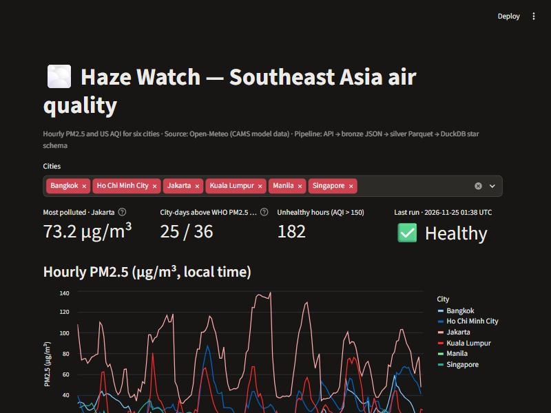
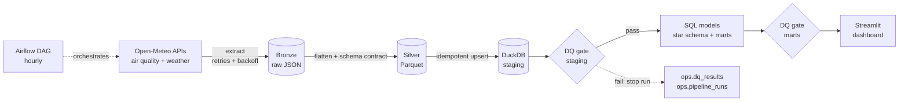
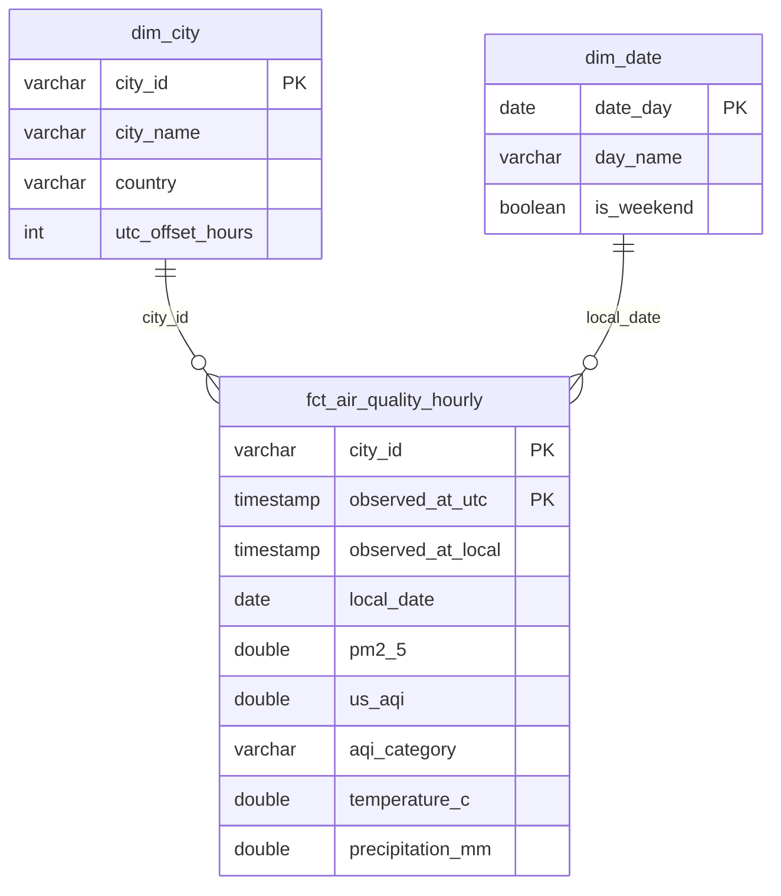

# 🌫️ Haze Watch

**An end-to-end data engineering pipeline that tracks air pollution across six Southeast Asian cities, hourly.**

Haze is a recurring public-health and business risk in Southeast Asia. It affects flights, schools, outdoor
workforces and insurers. Haze Watch ingests live air-quality and weather data, lands it in a layered data lake,
models it into a star-schema warehouse, gates every run with data-quality checks, and serves the results on a
dashboard.

 
 




---

## What it found (live run, 18–25 Nov 2026)

| City | Avg daily PM2.5 (µg/m³) | Days above WHO guideline | Unhealthy hours (AQI > 150) |
|---|---:|---:|---:|
| Jakarta | **73.2** (≈ 5× WHO) | 6 / 6 | 144 |
| Ho Chi Minh City | 30.9 | 6 / 6 | 0 |
| Kuala Lumpur | 29.5 | 6 / 6 | 0 |
| Bangkok | 20.4 | 4 / 6 | 7 |
| Singapore | 14.3 | 3 / 6 | 0 |
| Manila | 7.0 | 0 / 6 | 0 |

- **Jakarta was in one unbroken haze episode for 170+ hours** (US AQI > 100 the whole week, peak 221).
- **Bangkok shows a daily pattern:** all 6 of its episodes started between 16:00 and 17:00 local time, which points to
  evening traffic and boundary-layer effects rather than a one-off event.
- 11 haze episodes in total, detected automatically with a SQL gaps-and-islands model.

> Data: [Open-Meteo](https://open-meteo.com/) Air Quality API (Copernicus CAMS model) and Forecast API.
> These are modelled values, not ground-station readings. Fine for trend analysis, but not for regulatory use.

---

## Architecture



| Layer | Where | What happens |
|---|---|---|
| **Bronze** | `lake/bronze/<source>/ingest_date=/run_id=/<city>.json` | Raw API responses plus ingestion metadata. Can be replayed without calling the API again. |
| **Silver** | `lake/silver/<source>/ingest_date=/run_id=/part-0.parquet` | Nested JSON flattened to one row per city per hour. Typed, schema-validated, zstd-compressed. |
| **Staging** | `staging.*` (DuckDB) | Deduplicated history; incremental upsert on `(city_id, observed_at)` |
| **Marts** | `marts.*` (DuckDB) | Star schema: `fct_air_quality_hourly`, `dim_city`, `dim_date`, plus `mart_city_daily` and `mart_haze_episodes` |
| **Ops** | `ops.*` (DuckDB) | Audit log of every step and every data-quality result, for observability |

### Data model



---

## Engineering decisions

| Problem | How it's handled |
|---|---|
| **API is flaky.** During development the API dropped connections three times in one run. | Exponential-backoff retries on 429/5xx and connection errors only (4xx fails fast). One failing city doesn't block the others; the task fails at the end so Airflow retries it. |
| **Re-runs must not duplicate data** | Every load is an upsert keyed on `(city_id, observed_at)`, and every write goes to a deterministic path. Running the same hour twice gives an identical warehouse (tested). |
| **Backfills must not overwrite fresher data** | `ON CONFLICT ... DO UPDATE ... WHERE EXCLUDED.ingested_at >= target.ingested_at`, so replaying an old run is a no-op (tested). |
| **The API returns forecasts mixed with observations** | Silver flags `is_forecast` (later than ingestion time). Forecast hours stay in staging but never become facts. When a later run has the observed value, it replaces the forecast. |
| **Bad data must never reach the dashboard** | 13 SQL data-quality checks in two gates. `error` checks stop the run before transforms; `warn` checks are logged. Results are stored in `ops.dq_results`. |
| **Upstream schema drift** | Silver enforces a schema contract (required fields, equal array lengths) and fails loudly instead of loading misaligned rows. |
| **Partial transforms** | All SQL models run in one transaction, all or nothing. |
| **Time zones** | Ingest everything in UTC and convert to local time in the warehouse. Daily marts use the *local* calendar day. |
| **Adding a city** | Add it to `config/cities.yaml`. No code change needed. |

---

## Run it

**Requirements:** Python 3.11+ (Docker is optional).

```bash
python -m venv .venv
.venv\Scripts\activate            # Windows  (macOS/Linux: source .venv/bin/activate)
pip install -e ".[dashboard,dev]"

hazewatch run --past-days 7       # backfill a week of live data (about 30 seconds)
streamlit run dashboard/app.py    # http://localhost:8501
pytest -v                         # 12 tests, no network needed
```

Run one step at a time (this is what Airflow does):

```bash
hazewatch step extract --run-id 20261125T090000
hazewatch step silver --run-id 20261125T090000
hazewatch step load --run-id 20261125T090000
hazewatch step quality-staging --run-id 20261125T090000
hazewatch step transform --run-id 20261125T090000
hazewatch step quality-marts --run-id 20261125T090000
```

**With Docker + Airflow:**

```bash
docker compose run --rm pipeline          # one-off 7-day backfill
docker compose up -d airflow dashboard    # Airflow: http://localhost:8080 · Dashboard: http://localhost:8501
```

The DAG `haze_watch_hourly` runs at 15 minutes past each hour. Each pipeline step is its own task with retries,
and `max_active_runs=1` because DuckDB allows a single writer.

---

## Testing and CI

The tests run the **whole pipeline end to end against a fake API**, so CI needs no network or credentials:

- the full run builds every mart and logs every step
- re-runs are idempotent
- replaying an old run can't overwrite newer data
- an impossible value (PM2.5 = −5) is blocked at the staging gate, and no marts are built
- the CLI exits with code 2 on a data-quality failure, so schedulers can alert on it
- retry logic: retries 503s, never retries 400s
- schema contract: ragged or missing arrays are rejected

GitHub Actions (`.github/workflows/ci.yml`) runs `ruff` and `pytest` on every push, then builds the Docker image and
smoke-tests it.

---

## Project structure

```
haze-watch/
├── config/cities.yaml          # cities to track (config-driven)
├── src/hazewatch/
│   ├── extract.py              # API → bronze (retries, partial-failure handling)
│   ├── silver.py               # bronze → silver (flatten, schema contract, Parquet)
│   ├── warehouse.py            # silver → DuckDB (DDL, idempotent upsert, model runner)
│   ├── quality.py              # data-quality checks + gates
│   └── pipeline.py             # step functions, audit logging, CLI
├── sql/                        # warehouse models, run in order
│   ├── 01_dim_city.sql
│   ├── 02_fct_air_quality_hourly.sql
│   ├── 03_dim_date.sql
│   ├── 04_mart_city_daily.sql
│   └── 05_mart_haze_episodes.sql   # gaps-and-islands with window functions
├── dags/haze_watch_dag.py      # Airflow orchestration
├── dashboard/app.py            # Streamlit + Altair
├── tests/                      # end-to-end + unit tests with a fake API
├── Dockerfile · docker-compose.yml
└── .github/workflows/ci.yml
```

---

## Roadmap

- **Cloud:** swap DuckDB for BigQuery and the local lake for GCS, provisioned with Terraform
- **Streaming:** publish hourly readings to Kafka and alert in near real time when a haze episode starts
- **Scale:** move the silver step to PySpark once the city list grows into the hundreds
- **Modelling:** port the SQL models to dbt for lineage docs and built-in tests
- **Enrichment:** add NASA FIRMS fire hotspots to link haze episodes to regional burning
